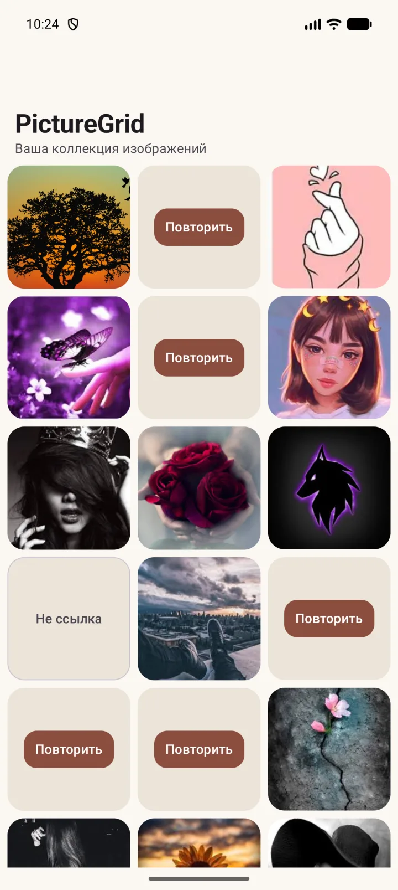
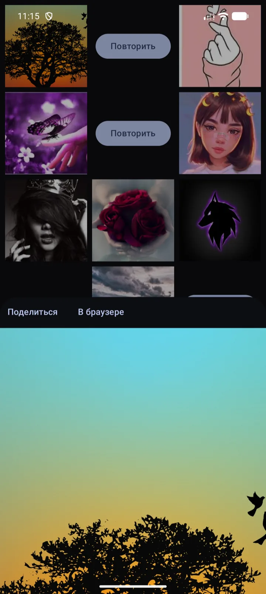
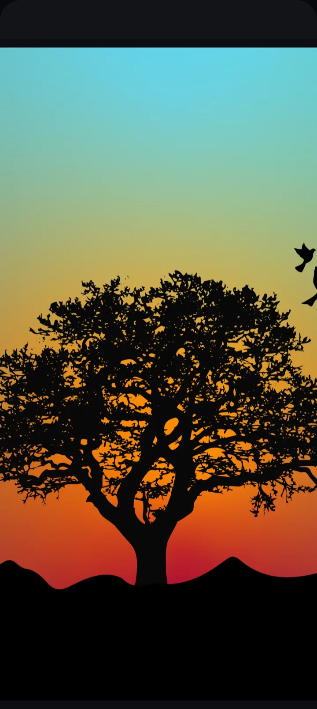
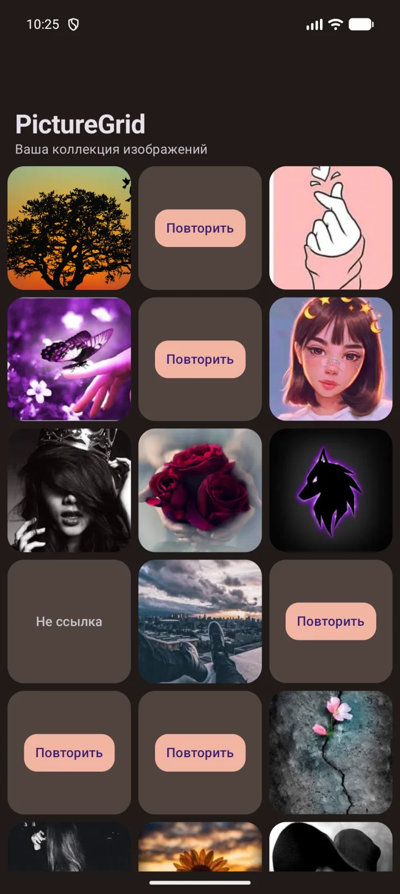
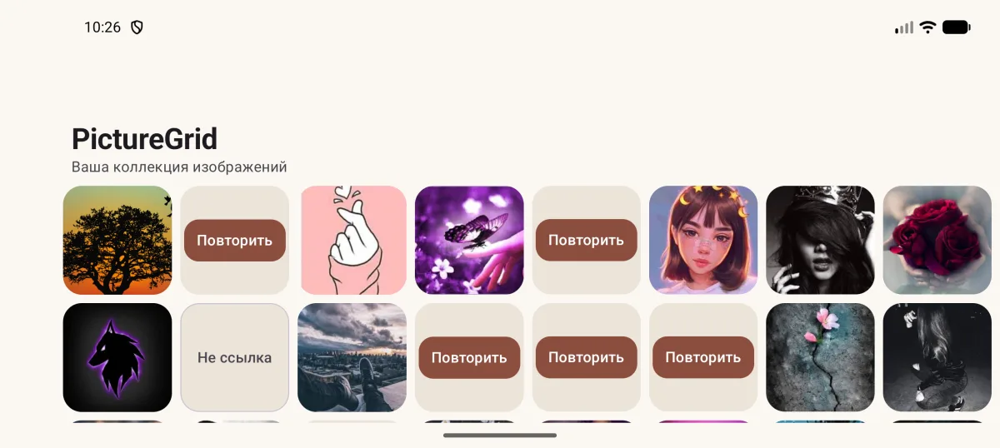
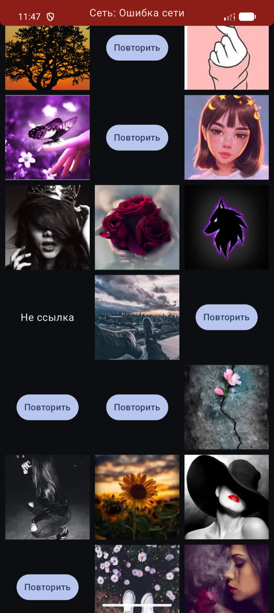

<div align="center">

# PictureGrid

**Android-галерея по списку URL: адаптивная сетка миниатюр, просмотр оригинала в BottomSheet, дисковое кэширование и полноценная работа без сети.**

[](https://kotlinlang.org)
[](https://developer.android.com/jetpack/compose)
[](https://developer.android.com/build)
[](https://gradle.org)
[-3DDC84?logo=android&logoColor=white)](https://developer.android.com)
[](#проверки)

</div>

---

## Скриншоты

<table>
  <tr>
    <td align="center"><br><sub><b>Галерея</b> — адаптивная сетка, заглушки и retry</sub></td>
    <td align="center"><br><sub><b>Просмотр</b> — оригинал в BottomSheet</sub></td>
    <td align="center"><br><sub><b>Полный экран</b> — скруглённый верхний угол сохранён</sub></td>
  </tr>
  <tr>
    <td align="center"><br><sub><b>Тёмная тема</b> — следует системной, Material You на API 29+</sub></td>
    <td align="center"><br><sub><b>Ландшафт</b> — 3 → 8 колонок по ширине окна</sub></td>
    <td align="center"><br><sub><b>Офлайн</b> — сохранённый список и кэш превью</sub></td>
  </tr>
</table>

> Эмулятор `Pixel_9_Pro` (Android 17, API 37), реальный список `https://it-link.ru/test/images.txt` — 61 строка.

---

## Что умеет приложение

- **Автоматическая загрузка списка** URL при запуске — построчно, с сохранением исходного порядка.
- **Дисковое кэширование списка** в приватном каталоге приложения: при недоступной сети используется ранее сохранённая копия.
- **Адаптивная сетка** `GridCells.Adaptive(100.dp)` — число колонок считается по фактической ширине окна, а не по ориентации, поэтому корректно работает на планшетах, в multi-window и при повороте экрана.
- **Три разных вида отказа** в ячейке: «Не ссылка» (строка не URL), «Не изображение» (URL отдаёт заведомо не-изображение) и «Повторить» (временная ошибка загрузки). Ячейка с ошибкой не открывает просмотр: клик показывает сообщение об ошибке, активно только действие «Повторить».
- **Просмотр оригинала в BottomSheet** — отдельная destination в back stack, системный Back закрывает лист и возвращает к галерее.
- **Постоянное хранение оригиналов** в приватном каталоге: оригинал читается с диска при повторном открытии и после перезапуска приложения.
- **Кэш превью** на Coil — отдельный от кэша оригиналов, с декодированием под размер ячейки.
- **Автоматическая повторная синхронизация** при восстановлении сети: список обновляется на экране, а не только в хранилище.
- **Светлая и тёмная темы** — следуют системной, с единой тёплой editorial-палитрой для предсказуемого визуального стиля.
- **Русскоязычные сообщения об ошибках** с явным действием «Повторить».

### Бонусные возможности

- **Приближение щипком**: масштаб 1–5, перетаскивание увеличенного изображения, двойное нажатие переключает исходный и увеличенный масштаб.
- **Перелистывание изображений** горизонтальным свайпом, рядом видны превью соседних изображений.
- **Полноэкранный режим**: панель действий, статус-бар и навигационная панель скрываются; системные панели возвращаются свайпом от края.
- **«Поделиться» и «В браузере»**: ссылка на изображение отправляется другим приложениям или открывается в браузере.

---

## Чеклист требований

### Обязательная часть задания

| # | Требование | Статус | Реализация |
|---|---|:---:|---|
| 1 | Список URL загружается автоматически при запуске | ✅ | `GalleryRepositoryImpl.refresh()` при инициализации Store |
| 2 | Список сохраняется в приватном каталоге и переживает перезапуск | ✅ | `GalleryListStorage` → `filesDir/gallery/list.txt`, атомарная запись |
| 3 | При недоступной сети используется сохранённая копия | ✅ | Репозиторий возвращает кэш при сетевой или storage-ошибке |
| 4 | Разбор каждой строки с сохранением порядка | ✅ | `GalleryListParser`, повторяющиеся строки получают разные `id` |
| 5 | Заглушка для не-ссылок | ✅ | `GalleryItem.Placeholder(NotUrl)` → «Не ссылка» |
| 6 | Заглушка для ссылок, не являющихся изображениями | ✅ | `ImageContentInterceptor` → «Не изображение», без retry |
| 7 | Повтор загрузки изображения при ошибке | ✅ | Кнопка «Повторить» повторяет запрос, а не перерисовку |
| 8 | Кэширование превью и повторное использование кэша | ✅ | Coil disk cache 50 МиБ + memory cache 25% памяти |
| 9 | Постоянное дисковое сохранение оригинала | ✅ | `ImageStorage` → `filesDir/images/originals`, квота 200 МиБ |
| 10 | Повторное использование оригинала после перезапуска | ✅ | Ключ — SHA-256 от URL, проверка целостности по сигнатуре файла |
| 11 | Просмотр оригинала в BottomSheet как отдельная destination | ✅ | `BottomSheetSceneStrategy`, скруглённые углы сохранены в expanded-состоянии |
| 12 | Адаптивное количество столбцов | ✅ | `GridCells.Adaptive(minSize = 100.dp)` |
| 13 | Корректная работа при повороте экрана | ✅ | Состояние Store переживает recreation, выбранный элемент не теряется |
| 14 | Светлая и ночная темы | ✅ | `PictureGridTheme` + `values/values-night` |
| 15 | Автоматическая повторная синхронизация после восстановления сети | ✅ | `NetworkMonitor` + `GallerySyncWorker` (`NetworkType.CONNECTED`) |
| 16 | Указание диапазона Android в README | ✅ | API 26–37 (Android 8.0+) |
| 17 | Приложение называется PictureGrid | ✅ | `app_name` в `strings.xml` |

### Бонусная часть задания

| # | Возможность | Статус |
|---|---|:---:|
| 18 | Приближение щипком, перетаскивание, двойное нажатие | ✅ |
| 19 | Перелистывание изображений свайпом | ✅ |
| 20 | Полноэкранный режим (immersive) | ✅ |
| 21 | Поделиться и открыть в браузере | ✅ |

### Проверка качества

| Требование | Статус | Тесты |
|---|:---:|---|
| Unit-тесты парсинга, типов элементов, reducer и состояний | ✅ | `GalleryListParserTest`, `GalleryStoreSmokeTest`, `GalleryStoreRefreshTest` |
| Обработка ошибок репозитория | ✅ | `GalleryRepositoryImplTest`, `GalleryRepositoryRetrofitTest` |
| Пустой файл, пустые строки, некорректный URL | ✅ | `GalleryListParserTest` |
| HTTP-ошибка, не-изображение с HTTP 200, повреждённое изображение | ✅ | `RetrofitNetworkClientTest`, `ImageContentInterceptorTest`, `ImageContentCheckerTest` |
| Отсутствие сети и повторная загрузка | ✅ | `GalleryNetworkRecoveryTest`, `NetworkErrorTest` |
| Оригинал читается с диска при повторном открытии | ✅ | `OriginalImageLoaderTest`, `ImageStorageTest` |
| Архитектурные правила (направление зависимостей) | ✅ | `ArchitectureKonsistTest` (Konsist) |
| Screenshot-эталоны светлой и тёмной темы | ✅ | `GalleryScreenshotTest`, `ThemeScreenshotTest`, `ViewerScreenshotTest` (Roborazzi) |
| Щипок и жесты просмотрщика | ✅ | `ViewerPinchGestureTest` (instrumentation), `ViewerGestureTest` (Robolectric) |

---

## Важные технические решения

- **Однонаправленный поток данных.** Экраны построены на MVIKotlin: `Intent → Executor → Message → Reducer → State → UI`. Состояние мутируется только через `_state.update { }`, UI остаётся stateless.
- **Дизайн-система вместо локальных заголовков.** Верхняя панель — компонент `PictureGridTopAppBar` на Material3 `MediumTopAppBar`: заголовок с подзаголовком, слоты навигации и действий, сворачивание при прокрутке задаёт экран. Строки приходят из ресурсов, компонент не знает текстов.
- **Один `ImageLoader` на приложение.** Загрузчик доступен UI через `LocalImageLoader` из `core:images` и провайдится один раз в `:app`: экраны не принимают его параметром, а второго экземпляра с отдельным кэшем не появляется.
- **Навигация — Navigation 3.** Фичи не трогают внутренний back stack напрямую: есть тонкая Router-обёртка в `core:navigation`, а лист просмотра — отдельная destination со своей scene strategy.
- **Feature-based модули с разделением `api` / `impl`.** `api` не знает о реализациях, `core` не импортирует фичи, composition root связывает контракты и реализации. Проверяется тестом Konsist и задачей `checkModuleDependencies`.
- **Compile-time DI через Koin Compiler Plugin.** Общая инфраструктура объявлена в `:app`, графы галереи и просмотрщика — в `feature/*/impl`. Production-синглтоны и ручные fallback-фабрики удалены; зависимости передаются через Koin, а граф проверяется компилятором.
- **Single-flight обновление списка.** Параллельные вызовы `refresh()` не создают параллельных запросов: общая загрузка выполняется один раз в своём scope, отмена одного вызывающего её не прерывает.
- **Retry-политика — в одном месте.** `NetworkError.isRetryable()` — единственный источник истины: временные сетевые ошибки, timeout, `EmptyBody`, HTTP 408/429/5xx повторяются, остальные 4xx и `TooLarge` — нет.
- **Проверка содержимого, а не только заголовков.** `ImageContentInterceptor` отбрасывает ответы по `Content-Type` **или** по сигнатуре первых байт, если тип ответа неоднозначен. Тело при этом не читается целиком.
- **Два разных кэша с разными гарантиями.** Превью — UI-кэш Coil, который может вытесняться. Оригиналы — `ImageStorage` с гарантией постоянного хранения, квотой 200 МиБ и LRU-очисткой.
- **Сохранение в файл атомарно.** Список пишется во временный файл и переносится через `Files.move(..., ATOMIC_MOVE)`; при ошибке записи ранее сохранённый список остаётся на диске.
- **Жёсткая защита цепочки поставок.** Проверка зависимостей включена в строгом режиме: сборка падает, если артефакт отличается от зафиксированной контрольной суммы.
- **Маленький release.** R8 включён: release APK — 1,6 МБ против 13,3 МБ у debug-сборки.

---

## Стек

| Компонент | Версия |
|---|---|
| Kotlin | 2.4.21 |
| Android Gradle Plugin | 9.4.1 |
| Gradle | 9.6.0 |
| JDK (daemon) | 25 |
| Compose BOM | 2026.09.00 |
| Navigation 3 | 1.2.0 |
| MVIKotlin | 4.4.0 |
| Koin / Compiler Plugin | 4.2.2 / 1.2.1 |
| Coil | 3.6.3 |
| Retrofit | 3.0.0 |
| OkHttp | 5.5.0 |
| kotlinx.coroutines | 1.11.0 |
| kotlinx.serialization | 1.11.0 |
| WorkManager | 2.12.0 |
| minSdk / targetSdk / compileSdk | 26 / 37 / 37 |

Тестовый стек: JUnit 4.13.2, Robolectric 4.17, Espresso 3.7.0, Konsist 0.18.1, Roborazzi 1.76.0.

Все версии вынесены в version catalog — [`gradle/libs.versions.toml`](gradle/libs.versions.toml).

---

## Архитектура

```text
:app                          composition root, навигация, тема, интенты
├── :feature:gallery:api      контракт галереи (State, Intent, Entry, NetworkMonitor)
├── :feature:gallery:impl     Store, репозиторий, парсер, сетка, заглушки
├── :feature:viewer:api       контракт просмотра
├── :feature:viewer:impl      просмотрщик, зум, полный экран, пейджер
├── :core:network             HTTP-клиент, NetworkError, лимиты ответа
├── :core:images              Coil ImageLoader, ImageStorage, проверка содержимого
├── :core:navigation          Router-обёртка над Navigation 3, BottomSheet strategy
└── :core:designsystem        светлая и тёмная темы, типографика
```

Направление зависимостей — строго внутрь:

```text
:app ──▶ feature:*:api, feature:*:impl, core:*
feature:*:impl ──▶ feature:*:api, core:*
feature:*:api ──▶ (только публичные типы)
core:* ──▶ (не зависят от фич)
```

Правило проверяется автоматически: `ArchitectureKonsistTest` и задача `checkModuleDependencies`.

---

## Кэширование и работа без сети

| Слой | Где лежит | Гарантия |
|---|---|---|
| Список URL | `filesDir/gallery/list.txt` | Постоянно, переживает перезапуск |
| Превью | Coil disk cache, `cacheDir/coil_image_cache`, 50 МиБ | Может вытесняться политикой кэша |
| Оригиналы | `filesDir/images/originals`, квота 200 МиБ | Постоянно, LRU-очистка, свежий файл не удаляется |

- `images.txt` не попадает в исходники или ресурсы проекта — только в приватный каталог приложения.
- Повторно используемый оригинал проверяется по сигнатуре файла: повреждённый удаляется и загружается заново.
- Каталог оригиналов исключён из облачного бэкапа и переноса устройства.

---

## Запуск

```bash
# Сборка debug APK
./gradlew assembleDebug

# Установка на устройство или эмулятор
./gradlew installDebug

# Release-сборка (R8 включён, подпись задаётся отдельно)
./gradlew assembleRelease
```

## Проверки

```bash
# Unit-тесты, lint, всё остальное
./gradlew check

# Один тест
./gradlew testDebugUnitTest --tests "com.example.picturegrid.SomeTest"

# Инструментальные тесты (нужно запущенное устройство или эмулятор)
./gradlew connectedDebugAndroidTest

# Screenshot-эталоны Roborazzi
./gradlew verifyRoborazziDebug

# Архитектурные тесты Konsist
./gradlew testDebugUnitTest --tests "com.example.picturegrid.architecture.ArchitectureKonsistTest"

# Проверка направлений зависимостей модулей
./gradlew checkModuleDependencies
```

### Проверка целостности зависимостей

Включена в строгом режиме (`org.gradle.dependency.verification=strict`): сборка
падает, если артефакт отличается от зафиксированного в
`gradle/verification-metadata.xml`.

**Если сборка упала с `Dependency verification failed` — не запускай
`--write-verification-metadata`.** Эта команда записывает в доверенные то, что
скачалось сейчас, и легализует подмену, если она была. Сначала посмотри, какой
артефакт и из какого репозитория не прошёл проверку:

```bash
./gradlew --dependency-verification=lenient assembleDebug
# режим lenient не падает и печатает все несоответствия с репозиториями
```

Дальше четыре случая:

| Что не прошло проверку | Что делать |
|---|---|
| `-sources.jar`, `-javadoc.jar`, `gradle:gradle` | `<trust>` в `<trusted-artifacts>`: это артефакты IDE, в сборку не попадают |
| Groovy и Kotlin-DSL-рантайм из репозитория `Gradle Libs` | `<trust>` по группе: версия привязана к версии Gradle, хешировать бессмысленно |
| обычная библиотека, версия которой изменилась | обновить снимок скриптом (ниже) |
| обычная библиотека, версия которой **не** менялась | остановиться: это и есть сценарий, ради которого проверка включена |

Обновление снимка — отдельное осознанное действие, всегда с нуля:

```bash
./scripts/update-verification-metadata.sh
git diff gradle/verification-metadata.xml   # прочитать, а не пролистать
```

Скрипт запускает `./gradlew`, а не системный `gradle`: снимок, снятый другим
Gradle, описывает другую сборку — другой дистрибутив, другие версии
поставляемых им артефактов. Файл пересобирается целиком, потому что генерация
поверх старого только дописывает записи и никогда не удаляет: так в нём и
накопились мёртвые версии 2021 года (`androidx.core:core:1.1.0`,
`androidx.compose.ui:ui:1.0.1`), которые сборка давно не резолвит.

---

## Поддерживаемые версии Android

| | |
|---|---|
| Минимальная версия | **Android 8.0 (API 26)** |
| Целевая версия | Android 17 (API 37) |
| Проверено на | API 26, API 30, API 37 |

Приложение проверено на API 26 (Android 8.0), API 30 (Android 11) и API 37: загрузка изображений, просмотр оригинала, темы, адаптивная сетка, работа без сети.

---

## Ограничения

- **Сервер из задания доступен не с всех версий.** `it-link.ru` принимает только TLS 1.3, а система поддерживает TLS 1.3 начиная с Android 10 (API 29). На API 26–28 список с этого сервера скачать нельзя — приложение показывает ошибку загрузки и использует ранее сохранённый список, если он есть. Код на API 26 проверен полностью через локальный HTTP-сервер на хосте.
- **Инструментальные тесты требуют API 30.** Espresso `3.7.0` — последняя стабильная версия — обращается к удалённому в API 36+ методу `InputManager.getInstance()` и на Android 17 падает с `NoSuchMethodException`. Поэтому instrumentation-тесты запускаются на эмуляторе `pg_api30`, где проходят.
- **Release APK собирается без production-подписи.** Сборка unsigned (`app-release-unsigned.apk`); ключ подписи задаётся отдельно, в репозиторий не попадает.
- **Cleartext разрешён только в debug-сборке** и только для `10.0.2.2` — адреса хоста из эмулятора. Нужно для ручных проверок на API 26–28. В release-сборку не входит.

---

## Структура репозитория

```text
app/                        composition root, Application, Activity, интенты
core/
  designsystem/             темы, типографика, верхняя панель
  images/                   Coil ImageLoader, ImageStorage, проверка содержимого
  navigation/               Router, BottomSheet strategy
  network/                  HTTP-клиент, NetworkError, лимиты
feature/
  gallery/api               публичный контракт галереи
  gallery/impl              Store, репозиторий, парсер, сетка
  viewer/api                публичный контракт просмотра
  viewer/impl               просмотрщик, зум, пейджер
gradle/                     version catalog, verification metadata
assets/readme/              изображения для README
```
